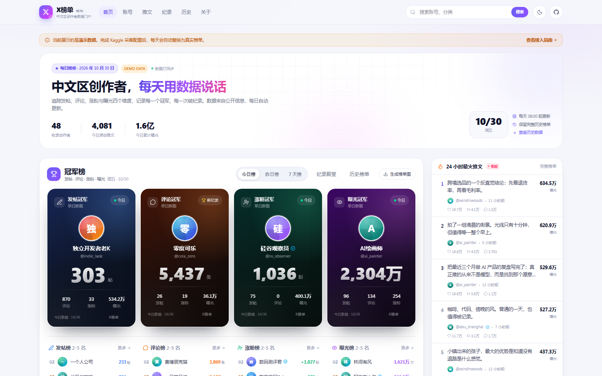

# X榜单 · 中文区创作者数据榜单

一个完全开源、零后端、每天自动更新的 X（Twitter）创作者排行榜。  
Kaggle 定时采集 → 推送 JSON 回 GitHub → GitHub Actions 构建 → GitHub Pages 发布。

[](https://github.com/retfings/x-bangdan)
[](https://github.com/retfings/x-bangdan)
[](https://github.com/retfings/x-bangdan)
[](https://github.com/retfings/x-bangdan)

> 在线站点：<https://retfings.github.io/x-bangdan/>  
> 徽章由每日采集任务自动更新，无需手动维护。Fork 后把 `retfings` 换成自己的 GitHub 用户名即可。



<sub>更多截图：[账号榜](docs/preview-accounts.png) · [推文榜](docs/preview-posts.png) · [纪录殿堂](docs/preview-records.png) · [历史榜单](docs/preview-history.png) · [账号详情](docs/preview-profile.png) · [榜单海报](docs/preview-poster.png) · [深色模式](docs/preview-dark.png) · [移动端](docs/preview-mobile.png)</sub>

## ✨ 功能

- **冠军榜**：发帖、评论、涨粉、曝光四个维度的每日 / 昨日 / 近 7 天冠军
- **账号榜**：全量创作者排名，支持维度、周期、分类、关键词筛选与环比箭头
- **推文榜**：按曝光、点赞、转发、评论排序的高热度原创推文
- **纪录殿堂**：四项单日历史纪录、破纪录时间线、历史单日 Top 10
- **历史榜单**：完整保留每一天的四项冠军，可按月份筛选
- **账号详情**：30 天趋势图、历史排名、纪录徽章、当日高曝光推文
- **榜单海报**：浏览器端 Canvas 生成冠军卡片 / 四宫格榜单图并下载 PNG
- **深浅色主题**、响应式布局、纯静态部署
- **自动数据徽章**：README 中的 shields.io 徽章跟随每日数据变化

## 🏗 架构

```text
┌──────────────────┐     GitHub API      ┌──────────────────┐
│ Kaggle Notebook  │ ──────────────────▶ │  GitHub Repo     │
│ 每天定时采集      │   daily/*.json      │  public/data/    │
│ twscrape / X API │   index.json        │  badge-*.json    │
└──────────────────┘                     └────────┬─────────┘
                                                  │ push → Actions
                                                  ▼
                                         ┌──────────────────┐
                                         │  GitHub Pages    │
                                         │  React + Vite    │
                                         └──────────────────┘
```

- **零后端**：所有页面都是静态文件，数据直接从仓库里的 JSON 读取
- **原子提交**：采集脚本通过 Git Data API 一次性提交当天数据和索引，避免半更新状态
- **可追溯**：每天的原始快照都保存在 `public/data/daily/`，历史可以完整重放

## 🚀 本地运行

环境要求：**Node.js ≥ 20.19 / 22.12**、**Python ≥ 3.11**（仅生成演示数据与采集时需要）。

```bash
git clone https://github.com/retfings/x-bangdan.git
cd x-bangdan
npm install
npm run dev
```

打开 <http://localhost:5173>。仓库内已经包含一次**真实采集快照**，不需要任何密钥就能预览。

```bash
# 生成 45 天演示数据（会覆盖 public/data 与 public/avatars）
# 仅建议在本地体验完整历史/纪录页时使用，不要提交覆盖真实数据
python scripts/generate_demo.py

# 构建静态站点
npm run build

# 预览构建结果
npm run preview

# 校验数据结构（CI 也会跑）
python scripts/validate_data.py
```

## 📦 部署到 GitHub Pages

1. 新建一个**公开**仓库（建议名为 `x-bangdan`），推送本仓库代码到 `main`。
2. 打开 **Settings → Pages → Build and deployment**，把 Source 设为 **GitHub Actions**。
3. 打开 **Settings → Actions → General**，确认 Workflow permissions 允许读写（默认即可）。
4. 推送后 `.github/workflows/deploy.yml` 会自动构建并发布。
5. 站点地址：`https://<username>.github.io/x-bangdan/`。

> Vite 使用相对路径 `base: './'`，因此不需要改配置就能部署在任意子路径。
> 如果使用自定义域名，在 `public/` 下添加 `CNAME` 文件即可。

## 🧠 Kaggle 每日采集

### 1. 创建 Notebook

在 Kaggle 新建 Notebook，上传（或复制）本仓库的 `kaggle/xbangdan_daily.ipynb`，并开启：

- **Internet**：Settings → Internet → On
- **Accelerator**：None（纯 API 采集不需要 GPU）

也可以直接用 Kaggle CLI：

```bash
# 修改 kaggle/kernel-metadata.json 里的 id 为 <你的用户名>/x-bangdan-daily
kaggle kernels push -p kaggle
```

### 2. 配置 Secrets

Kaggle Notebook → **Add-ons → Secrets**：

| Secret | 必填 | 说明 |
| --- | --- | --- |
| `GITHUB_TOKEN` | ✅ | Fine-grained PAT，目标仓库 **Contents: Read and write** |
| `GITHUB_REPO` | ✅ | `owner/name`，例如 `retfings/x-bangdan` |
| `GITHUB_BRANCH` |  | 默认 `main` |
| `X_ACCOUNTS` | 二选一 | twscrape 账号 / cookies 的 JSON 数组 |
| `X_BEARER_TOKEN` | 二选一 | X API v2 Bearer Token |
| `XB_SOURCE` |  | `auto` / `twscrape` / `x_api`，默认 `auto` |
| `XB_TIMEZONE` |  | 默认 `Asia/Shanghai` |

`X_ACCOUNTS` 示例（**只放在 Kaggle Secrets，绝对不要提交到仓库**）：

```json
[
  {
    "username": "your_x_username",
    "password": "your_password",
    "email": "your_email@example.com",
    "email_password": "your_email_password",
    "cookies": "auth_token=...; ct0=..."
  }
]
```

> `cookies` 与 `password` 二选一即可。cookies 过期后需要重新获取。
> 使用 twscrape 时建议准备 1–3 个专用采集账号，并控制并发与频率。

### 3. 设置每天运行

仓库内置了 `.github/workflows/kaggle-daily.yml`，每天 **15:40 UTC（北京时间 23:40）** 通过 Kaggle API 自动触发 Notebook，无需打开 Kaggle 页面。只需在 GitHub 仓库 Secrets 中添加 `KAGGLE_ACCESS_TOKEN`（Kaggle API Token）。

也可以在 Kaggle Notebook 右上角 **Schedule** 里设置 **Daily / 15:40 UTC**，二选一即可。

采集脚本默认采集 `XB_TIMEZONE`（默认 `Asia/Shanghai`）下的**当天**数据。  
补历史可以手动执行：

```bash
python scraper/collect.py --date 2026-10-01 --source auto
```

### 4. 手动运行一次

```bash
export GITHUB_TOKEN=ghp_xxx
export GITHUB_REPO=retfings/x-bangdan
export X_BEARER_TOKEN=xxx

python scraper/collect.py --source auto --require-push
```

没有凭据时也可以只写本地文件：

```bash
python scraper/collect.py --source twscrape --no-push
```

### 数据源对比

| 方式 | 曝光数 | 配置难度 | 说明 |
| --- | --- | --- | --- |
| `twscrape` | ✅ | 中 | 需要 X 账号 / cookies，推荐用于完整榜单 |
| `x_api` | ✅（取决于套餐） | 低 | 官方 API v2，受套餐速率与字段限制 |
| 演示数据 | 合成 | 无 | 仅用于本地预览与 UI 开发 |

> `twscrape` 默认每个账号最多读取 `XB_TWEET_LIMIT`（默认 200）条时间线。对日更或回复量特别大的账号，可以把它提高到 500–1000，但采集时间与账号风险也会上升。

## 🏷 自动更新的数据徽章

采集脚本每天会写入 4 个 shields.io endpoint 文件：

```text
public/data/badge-accounts.json      # 收录创作者数
public/data/badge-updated.json       # 最新数据日期
public/data/badge-posts.json         # 当日发帖总数
public/data/badge-impressions.json   # 当日曝光总量
```

在 README 中引用：

```markdown


```

把 `OWNER/REPO` 换成自己的仓库即可。徽章不是静态图片，每次 Kaggle 任务提交后都会自动变化。

## 🗂 数据结构

```text
public/data/
├── index.json                 # 站点索引：日期、纪录、历史、账号序列
├── badge-accounts.json        # shields.io endpoint
├── badge-updated.json
├── badge-posts.json
├── badge-impressions.json
└── daily/
    └── 2026-10-30.json        # 当天账号明细 + 高曝光推文
```

`index.json` 关键字段：

```jsonc
{
  "latest": "2026-10-30",
  "dates": ["2026-09-16", "..."],
  "totals": { "accounts": 48, "posts": 4174, "impressions": 164441159 },
  "records": {
    "posts": { "value": 449, "handle": "crossborder", "date": "2026-10-24" }
  },
  "history": [
    { "date": "2026-10-30", "champions": { "posts": { "handle": "...", "value": 196 } } }
  ],
  "series": {
    "handle": {
      "name": "显示名",
      "avatar": "https://...",
      "bio": "一句话简介",
      "category": "AI",
      "followers": 123456,
      "posts": [0, 12, 9],
      "replies": [0, 80, 55],
      "followersGain": [0, 120, 98],
      "impressions": [0, 120000, 98000]
    }
  }
}
```

`daily/YYYY-MM-DD.json`：

```jsonc
{
  "schemaVersion": 1,
  "date": "2026-10-30",
  "source": "twscrape",
  "accounts": [
    {
      "handle": "example",
      "name": "示例账号",
      "followers": 123456,
      "posts": 12,
      "replies": 80,
      "followersGain": 120,
      "impressions": 120000
    }
  ],
  "tweets": [
    { "id": "123", "text": "...", "impressions": 52000, "url": "https://x.com/..." }
  ]
}
```

完整字段说明见 [`docs/data-schema.md`](docs/data-schema.md)。

## 📁 目录结构

```text
x-bangdan/
├── src/                     # React 前端
│   ├── components/          # 冠军卡、榜单、抽屉、布局
│   ├── pages/               # 首页 / 账号 / 推文 / 纪录 / 历史 / 关于
│   └── lib/                 # 数据加载、聚合、格式化、海报导出
├── public/data/             # 每日数据与索引（由采集任务写入）
├── public/avatars/          # 演示数据头像
├── scraper/
│   ├── collect.py           # 采集入口
│   ├── sources.py           # twscrape / X API
│   ├── aggregate.py         # 索引、纪录、徽章聚合
│   └── github_publisher.py  # GitHub 原子提交
├── scripts/
│   ├── generate_demo.py     # 生成演示数据
│   └── validate_data.py     # 数据校验
├── kaggle/                  # Kaggle Notebook 与 metadata
├── config/accounts.json     # 要追踪的账号列表
└── .github/workflows/       # Pages 部署 + 数据校验
```

## 🛠 自定义

- **追踪账号**：编辑 `config/accounts.json` 的 `accounts` 数组，提交后下一次采集生效
- **网站名称 / 仓库链接**：修改 `src/config.ts`；构建时也可注入 `VITE_GITHUB_REPO`
- **主题色**：修改 `src/index.css` 顶部的 CSS 变量与 `@theme`
- **统计时区**：设置 `XB_TIMEZONE`（默认 `Asia/Shanghai`）
- **保留天数**：当前保留全部历史；如需裁剪可自行在 `collect.py` 中增加清理逻辑

## ❓常见问题

**为什么数据和我看到的不一样？**  
X 的曝光数、粉丝数存在缓存与延迟；采集时间点不同也会造成差异。榜单以每日快照为准，并保留原始数据供核对。

**演示数据是真的吗？**  
仓库默认保存真实采集快照；`scripts/generate_demo.py` 生成的 45 天合成数据仅用于本地体验完整历史，页面会显示 DEMO 标识。首次真实采集会替换掉演示数据。

**会被 X 封号吗？**  
任何非官方采集都存在风险。请使用专用账号、降低频率、遵守 X 的服务条款，并自行承担使用风险。

**如何申请收录 / 移除账号？**  
直接开 Issue，模板已经准备好。

## 🗺 Roadmap

- [ ] 话题 / 关键词榜
- [ ] 海外区、涨粉黑马、冻结名单
- [ ] 榜单海报模板自定义
- [ ] 数据导出 CSV / API
- [ ] MCP Server（让 AI 直接查询榜单）

## ⚖️ 声明

- 本项目仅聚合 X 上公开可见的数据，与 X Corp. 无任何关联。
- 榜单数据仅供参考，可能存在延迟、缺失或统计误差，不构成投资建议。
- 请遵守 X 的服务条款与当地法律法规，合理控制采集频率。

## 📄 License

[MIT](LICENSE) © 2026 X榜单 contributors
